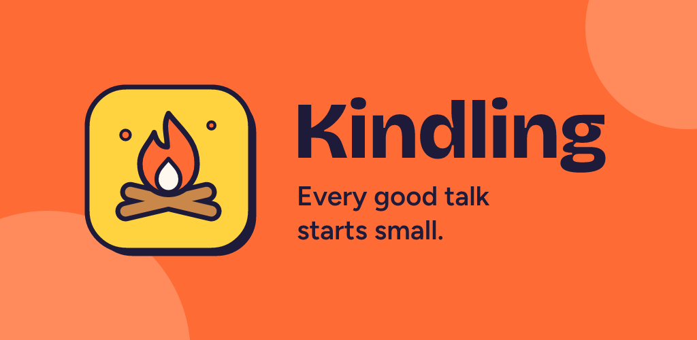

<p align="center">
  
</p>

<p align="center"><b>One conversation topic at a time, with a gentle timer, so a talk never stalls and never drags.</b><br>
Una conversación, un tema a la vez. In English and Spanish.</p>

---

## Why "Kindling"?

Kindling is the small stuff you use to start a fire: twigs, dry leaves, a few thin sticks. Big logs don't catch on their own. Conversations work the same way. A small, good question gets things going; when it catches, you feed it more time. When it doesn't, you let it go out and light another.

That's the whole app.

## How a round goes

```
  pick a vibe  ──►  a topic appears  ──►  talk while the ring drains  ──►  time's up
                          ▲                                                   │
                          └──────────── next  ◄──  or  +1 min, go deeper ◄────┘
```

1. **Pick a vibe.** Choose one or more categories and how deep to go, or tap **Random topic**.
2. **A card appears.** One question, big and readable, with a ring around it that slowly drains. No ticking numbers.
3. **Talk.** Tap the card to pause when the waiter arrives.
4. **Time's up** is a soft vibration and a small chime, never an alarm. Add a minute and a follow-up question appears, or move on to the next card.

## Every topic has three layers

| | Example |
| --- | --- |
| **The question** | *Tell me about the best meal you've ever had.* |
| **A spark**, if nobody knows how to start (tap "Need a spark?") | *Start with where you were and what it smelled like.* |
| **A follow-up**, when you add time and want to go deeper | *Who were you with?* |

## Nine flavors

Each category has its own color and its own little flame.

| Category | Feels like | A taste |
| --- | --- | --- |
| Get to know you | Sunny yellow, a first hello | *If your life came with a warning label, what would it say?* |
| Deep talk | Dusk blue, late-night talks | *What does "home" mean to you: a place, a person, or a feeling?* |
| Random facts | Teal, a lightbulb moment | *Wombats poop in cubes. If you could change the shape of one everyday thing, what would it be?* |
| Stories | Ember orange, tales around the fire | *Tell me about the worst haircut you've ever had.* |
| Would you rather | Violet, impossible choices | *Would you rather have a dragon or be a dragon?* |
| Light debate | Coral, a little heat, never politics | *Is water wet?* |
| Couples | Rose, just the two of you | *If we had a reality show, what would it be called?* |
| Family and kids | Leaf green, safe for all ages | *If your family were a kind of weather, what would it be?* |
| Team building | Sky blue, work-friendly | *If our team had a mascot, what would it be?* |

180 topics so far (20 per category), each written in English and in neutral, gender-neutral Spanish, at three depths: light, medium and deep.

## Little things that matter

- **Day and night.** Bold, playful stickers by day. At night the campfire is lit, with an optional crackling fire in the background.
- **Your rhythm.** Topics last 30 seconds to 5 minutes, or turn the timer off and just use the cards.
- **Favorites.** Save the topics that worked and play them with your next group, or share one with a friend.
- **Never stuck.** No repeats in a round. When you've seen them all, shuffle again or mix in another category.
- **Accessible.** Every gesture has a button, text passes WCAG AA contrast in both themes, and decorative motion stops when Reduce Motion is on (the timer ring keeps moving, since it's how you see the time).

## Private by design

No accounts, no ads, no analytics, no internet needed. Your settings and favorites live only on your phone and disappear when you uninstall. Read the full [privacy policy](https://jorgecarnicero.github.io/Kindling/privacy/).

## Status

Preparing for **Google Play** (closed testing first). iPhone comes later.

---

## For developers

Kindling is a React Native app built with Expo, in TypeScript.

### Run it

You need Node 22.13+ (or 24+) and, for the content tools, [uv](https://docs.astral.sh/uv/) (Python).

```bash
npm install
npx expo start        # scan the QR code with Expo Go on your phone
```

### Check it

```bash
npm run typecheck     # TypeScript
npm test              # Jest: timer, deck, settings, i18n, theme contrast
npm run validate:topics
```

### Stack

| Piece | Choice |
| --- | --- |
| App | Expo SDK 58, React Native, TypeScript, Expo Router |
| State and storage | Zustand + AsyncStorage (on-device only) |
| Animation and drawing | Reanimated, react-native-svg |
| Sound and haptics | expo-audio, expo-haptics |
| Languages | i18next + expo-localization (EN, ES) |
| Fonts | Bricolage Grotesque, Figtree |
| Tests | Jest, React Native Testing Library |
| Builds | EAS Build (`preview` = installable APK, `production` = Play .aab) |

### Where things live

```
src/
  app/          screens: welcome, pick, play, favorites, settings
  components/   the sticker UI: Sticker, Button, TopicCard, TimerRing, CampfireLogo…
  data/         topics.json (the topic bank) and its types
  deck/         drawing cards: filters, shuffle, no repeats, follow-ups
  timer/        the countdown, as pure functions of the clock
  feedback/     time's-up vibration and chime, campfire ambience
  i18n/         en.json, es.json
  store/        settings, favorites, last selection
  theme/        day and night palettes, category colors
scripts/        topic tools, sound and icon generators
assets/         app icon, splash, sounds (generated)
design/         SVG masters of every graphic
store/          Google Play listing text and graphics
docs/           the public website and privacy policy (GitHub Pages)
```

### Adding topics

Topics live in [`src/data/topics.json`](src/data/topics.json). Each one has an id, a category, a depth, group sizes, the question, a spark and at least one follow-up, all in both languages:

```json
{
  "id": "story-006",
  "category": "stories",
  "depth": "light",
  "groupSize": ["pair", "small", "party"],
  "text": { "en": "Tell me about the worst haircut you've ever had.", "es": "Cuéntame sobre el peor corte de cabello que has tenido." },
  "starter": { "en": "Start with who cut it and what you asked for.", "es": "Empieza por quién te lo cortó y qué pediste." },
  "followUps": { "en": ["Is there photographic evidence?"], "es": ["¿Hay pruebas fotográficas?"] }
}
```

Write a batch in a separate file, then:

```bash
npm run add:topics -- my-batch.json      # adds new topics, grouped by category
npm run patch:topics -- my-patch.json    # changes fields on existing topics by id
npx prettier --write src/data/topics.json
npm run validate:topics
```

House style for topics:

- **Warm and playful, never cheesy.** No politics, ever.
- **Neutral Spanish** that works in Spain and Latin America, and **gender-neutral** wording ("una persona desconocida", not "un desconocido").
- **Say "your family"**, so the question works with relatives and with someone you just met.
- **Random facts must be true.** Hedge ("studies suggest") when the evidence is thin.
- **Never renumber or reuse an id.** Favorites are saved by id on people's phones.

### Regenerating sounds and graphics

Everything is generated from code in this repo, so it's ours and license-free:

```bash
npm run make:chime    # the time's-up chime
npm run make:fire     # the campfire ambience loop
npm run make:icons    # app icon, splash, favicon, store graphics, SVG masters
```

### Building

```bash
npx eas-cli build --platform android --profile preview      # APK to install directly
npx eas-cli build --platform android --profile production   # .aab for Google Play
```

## Credits

- Fonts: [Bricolage Grotesque](https://fonts.google.com/specimen/Bricolage+Grotesque) and [Figtree](https://fonts.google.com/specimen/Figtree), both under the SIL Open Font License.
- Logo, icons, chime and fire sound: made for Kindling
- Made by [Jorge Carnicero](https://github.com/jorgecarnicero).
